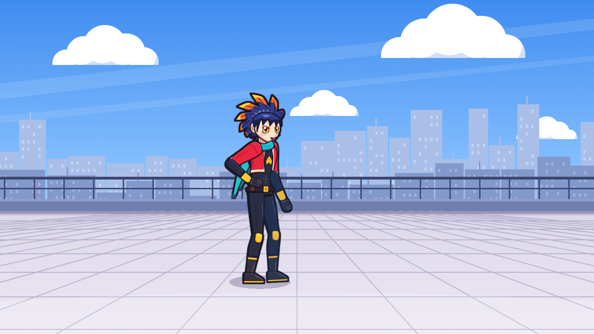
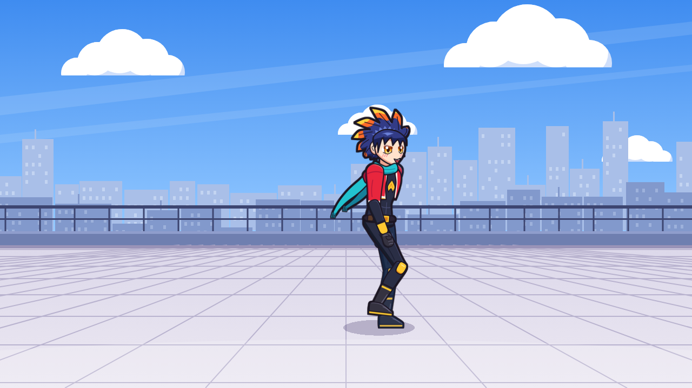

# Nocturne Anime – hero art experiment (Godot 4.3)

Original character **Homura Kagari**: an anime-style hero you can walk around a rooftop with
**WASD / arrow keys**. Open the folder in Godot 4.3 and press F5.

 

All artwork can be replaced with hand-drawn versions without touching code: save `walk_03.png`
next to `template_walk_03.png` and run the game.

- [docs/SPRITE_DRAWING_GUIDE.md](docs/SPRITE_DRAWING_GUIDE.md) – drawing & replacement workflow
- [docs/PROJECT_STRUCTURE.md](docs/PROJECT_STRUCTURE.md) – folders and architecture
