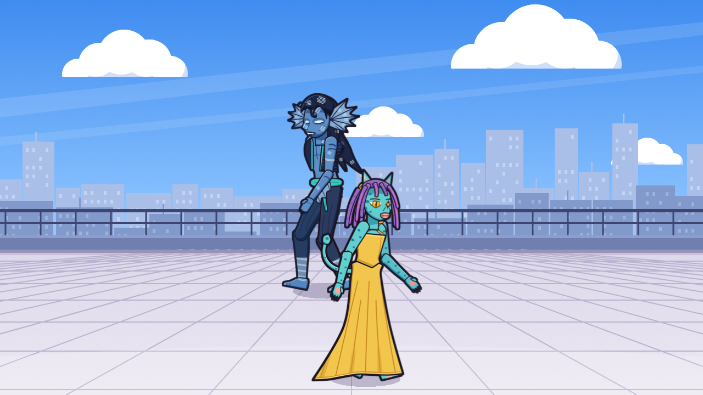

# Nocturne Anime – Atlas & Fishcat (Godot 4.3)

Two playable characters on one keyboard, based on the hand-drawn references in `assets/references/`:

| Character | Controls |
|---|---|
| **Atlas** – blue amphibious humanoid with head fins | WASD |
| **Fishcat** – turquoise spotted cat-folk in a yellow dress | Arrow keys |

Open the folder in Godot 4.3 and press F5.

All character artwork can be replaced with hand-drawn versions without touching code: save
`walk_03.png` next to `template_walk_03.png` and run the game.

- [docs/SPRITE_DRAWING_GUIDE.md](docs/SPRITE_DRAWING_GUIDE.md) – drawing & replacement workflow
- [docs/PROJECT_STRUCTURE.md](docs/PROJECT_STRUCTURE.md) – folders and architecture
