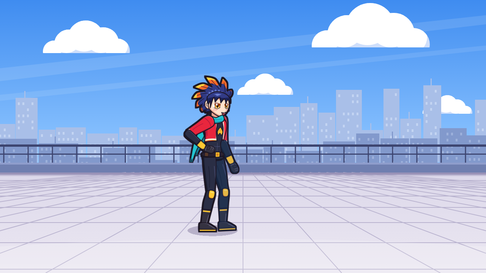
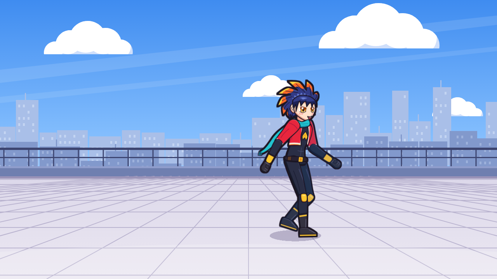

# Nocturne Anime – hero art experiment (Godot 4.3)

Original character **Homura Kagari** ("ember" hero student): indigo spiky hair with flame-coloured tips,
gold eyes, cropped crimson jacket, teal scarf, dark bodysuit with gold accents.

Open the folder in Godot 4.3 and run (F5). Move with **WASD / arrow keys**.

 

## How the artwork was made
No image generator or downloaded art – every shape is hand-authored vector data in `art_src/`:

- `character.py` – a 2D cut-out rig. Each body part (hair, face, eyes, jacket, limbs, boots…) is a spline
  shape I placed point by point in its own bone space. Cel shading is generated per part by subtracting a
  copy of the shape shifted toward a fixed world light, so the shadow side stays consistent while limbs
  rotate; a thinner opposite pass adds rim light. Joints are hidden by costume pieces (sleeve cuffs,
  knee pads, boots). A dilated-silhouette filter gives the heavier outer ink line.
- `animate.py` – poses the rig per frame: walk legs are solved with 2-bone IK (planted stance foot moving at
  constant speed, heel-strike/toe-off foot roll, pelvis bob), arms counter-swing with a slight lag, hair
  and scarf use phase-delayed secondary motion. Idle = breathing loop with a blink. Frames are rasterized
  with headless Chromium at in-game size, packed into sheets and a `SpriteFrames` resource.
- `background.py` – simple cel sky / skyline / rooftop backdrop.

Regenerate (needs Python + Pillow, Node + Playwright):
`python3 art_src/animate.py /tmp/frames` and
`python3 art_src/background.py /tmp/background.svg && node art_src/render.js art /tmp/background.svg`.
